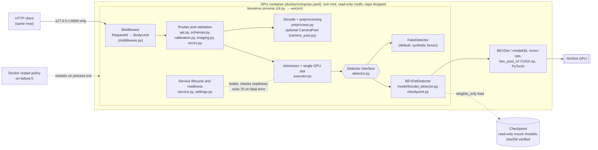

# Architecture

BEVServe is one Python process: a uvicorn/FastAPI app serving one detector on one GPU. This page
describes the code as of the current commit. Module names refer to `src/bevserve/`.

## Components and deployment boundaries



**Boundaries:**
- **Network:** the API is published on the host's loopback only. Outside a container the server
  refuses a non-loopback bind unless it is allow-listed (`bind.py`).
- **Model assets:** the checkpoint is never in the image. It is mounted read-only, must resolve
  inside the allowed directory, and is hash-checked on the exact bytes loaded.
- **Process supervision:** Docker restarts the container on process exit, not on health status.
  `/readyz` reports state; it does not trigger restarts.
- **Without a container**, the same process runs on a host (FakeDetector by default, or the real
  model in a prepared environment).

## Lifecycle of a six-camera inference request

```mermaid
sequenceDiagram
    autonumber
    participant C as Client
    participant L as Event loop (api._detect)
    participant W as Worker thread (anyio)
    participant S as GPU slot thread (executor)
    C->>L: POST /v1/detect (multipart: 6 images + calibration)
    Note over L: RequestId and BodyLimit middleware (413 if over MAX_REQUEST_BYTES)
    L->>L: readiness gate (503 not_ready)
    L->>L: multipart parse (415 not multipart, 413 part over its limit, 400 malformed)
    L->>L: parts, calibration JSON, image headers (422 / 413 / 415)
    L->>L: executor.try_admit() (non-blocking)
    alt all max_in_flight tokens taken
        L-->>C: 503 queue_full, Retry-After: 1
    end
    L->>W: decode + preprocess (serial, or six cameras on the CameraPool)
    W-->>L: model inputs (byte-identical in both modes)
    L->>S: executor.run(inputs, deadline)
    Note over S: one detect() at a time; queued jobs wait for the slot
    alt deadline passes
        L-->>C: 504 deadline_exceeded (a running job keeps the slot until it finishes)
    else detector error
        L-->>C: 500 inference_failed
    else fatal detector error
        L-->>C: 500 inference_fatal, then not ready and process exit 70
    end
    S-->>L: detections (admission token released when the job ends)
    L-->>C: 200 JSON: boxes in ego@CAM_FRONT_LEFT, model identity, stage timings
```

**Ordering facts the diagram encodes:**
- **Admission comes after validation.** A request is only admitted after its whole upload is
  parsed and validated, so a malformed request never takes a slot. The cost is that under
  overload, rejected requests are still fully parsed (see [m7-report.md](m7-report.md); an
  earlier-rejection variant was tested and not adopted, see [m8-report.md](m8-report.md)).
- **What the token covers:** decode, preprocessing, the GPU queue and execution.
- **When the token is released:** when the GPU job ends, or on leaving the request if no job was
  submitted. Exceptions and cancellation cannot leak it (tested).

## Failure semantics

| Situation | Behaviour |
| --- | --- |
| Initialization failure (wrong checkpoint hash, no CUDA device, missing custom op) | process stays up; `/readyz` 503 with reason (`checkpoint_hash_mismatch`, `cuda_unavailable`, `model_stack_missing`); no crash loop |
| Admission full | 503 `queue_full`, `Retry-After: 1`; nothing queued beyond `max_in_flight` |
| Deadline (default 10 s) | 504; a job that has not started is cancelled; a running job finishes and its result is discarded |
| Detector error | 500 `inference_failed`; service stays ready |
| Fatal detector error (e.g. CUDA failure) | 500 `inference_fatal`; not ready; process exits with code 70 after a grace period, and the supervisor restarts it. Requests in flight are lost: there is no durable queue |
| Client disconnect during upload | known defect: an unhandled `ClientDisconnect` is logged with a traceback; no token or resource leaks ([m7-report.md](m7-report.md)) |

## Design trade-offs

| Choice | Alternative | Why, and what it costs |
| --- | --- | --- |
| Reject when full (bounded admission, 503 + `Retry-After`) | unbounded or long queue | Latency stays bounded and memory is predictable. The cost: clients must retry, and under overload from clients that ignore `Retry-After`, admitted-request latency still rises (M7) |
| One GPU execution slot, no batching | dynamic batching, several streams | Simple, deterministic outputs (bit-identical repeats), and easy to reason about. The cost: throughput is capped by single-request GPU time once CPU work is parallel (M6) |
| Serial preprocessing by default, thread pool opt-in | pool by default | The pool cuts concurrency-1 latency to 0.302× with identical inputs (M6), but under overload it missed the M7 criterion, so the verified serial path stays the default |
| Exit with code 70 on fatal errors | in-process recovery | A clean restart by the supervisor after CUDA faults, instead of a half-broken process. The cost: in-flight requests are lost |
| Stay up and not ready on initialization failure | crash | No crash loop on a wrong hash or missing GPU; the reason is visible in `/readyz` |
| Loopback-only by default; checkpoint hash required | open bind; trust the file | Safe defaults for a research model service. Exposing it needs explicit configuration |
| Exact dependency pins; model-environment versions for numpy, Pillow and OpenCV | ranges | Pixel-level preprocessing parity depends on them. The cost: Python 3.10 only, and upgrades need the parity checks re-run |
